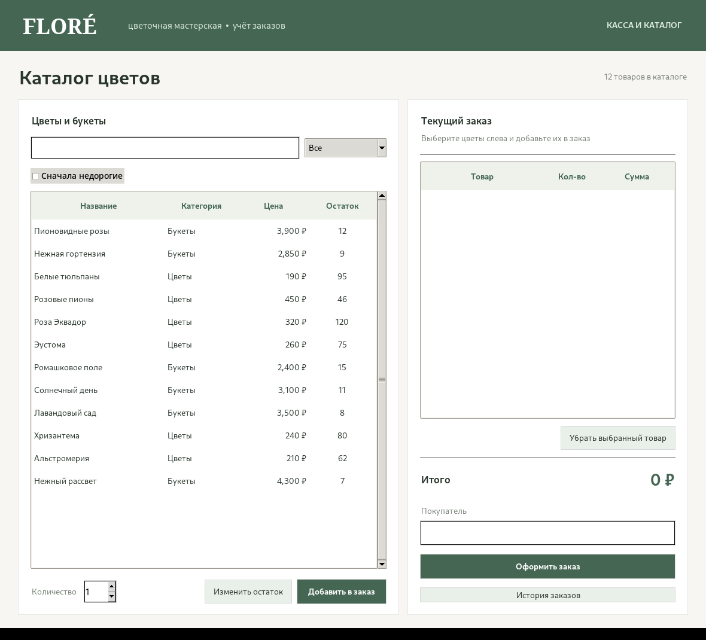
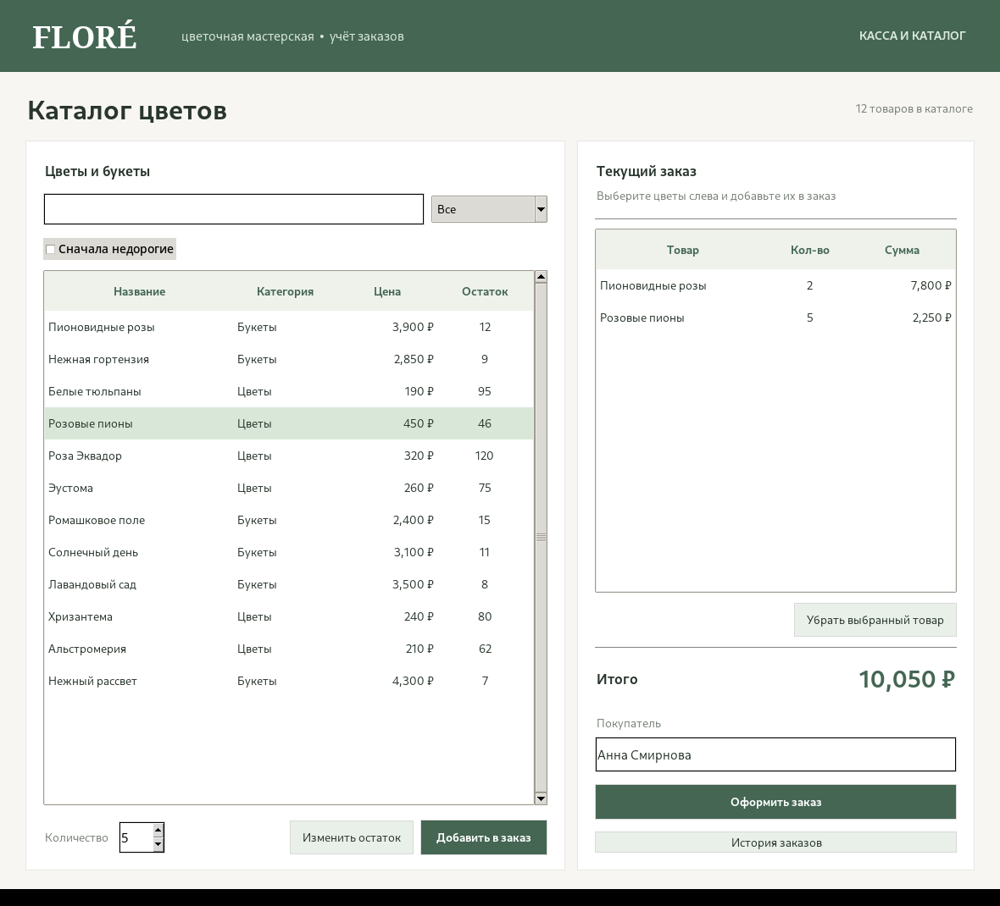
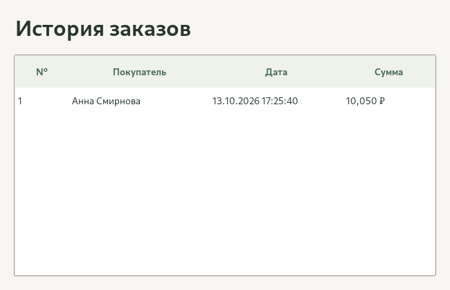

# Floré — цветочный магазин

Десктопное приложение для учёта цветов и оформления заказов. Написано на Python с использованием Tkinter и SQLite.

## Структура

- `shop/models` — модели товара, заказа и каталога
- `shop/repositories` — абстрактный репозиторий и реализация на SQLite
- `shop/services` — работа с заказами и отчётами
- `shop/ui` — компоненты интерфейса и главное окно
- `tests` — тесты основных операций
- `main.py` — запуск программы


```bash
python main.py
```

При первом запуске база создаётся автоматически в `data/flower_shop.db`. После закрытия приложения отчёт сохраняется в `reports/work_report.txt`.

Проверка тестов:

```bash
python -m unittest discover -s tests -v
```

## Скриншоты

### Каталог



### Оформление заказа



### История заказов


